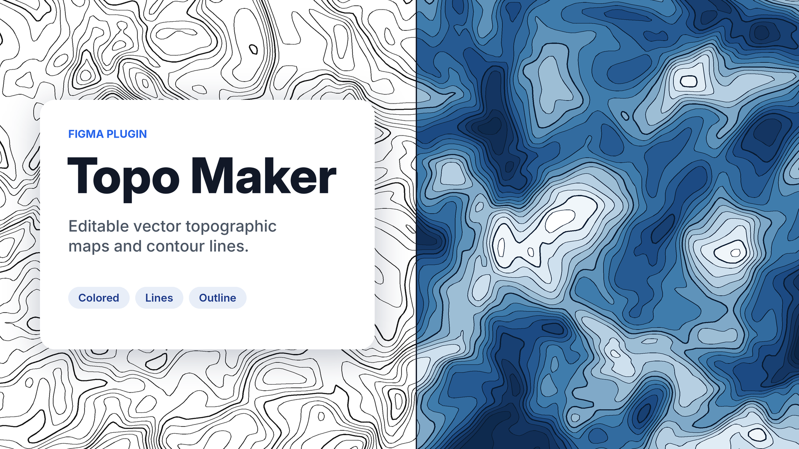
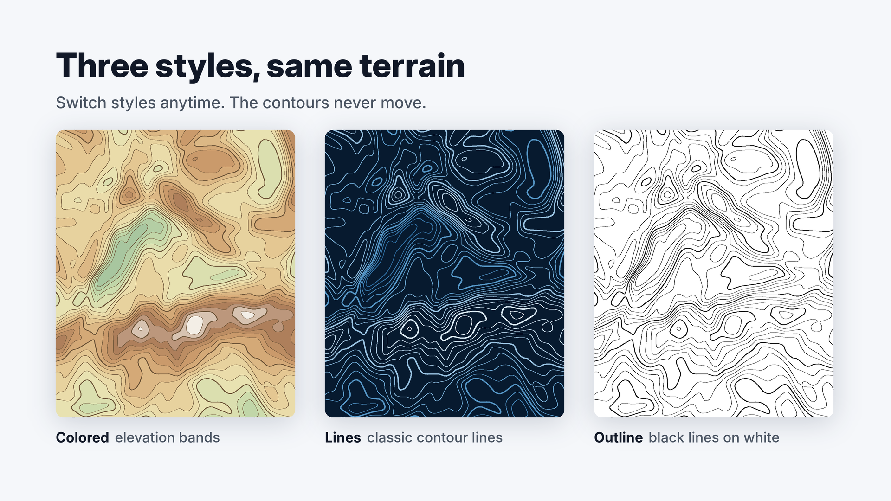
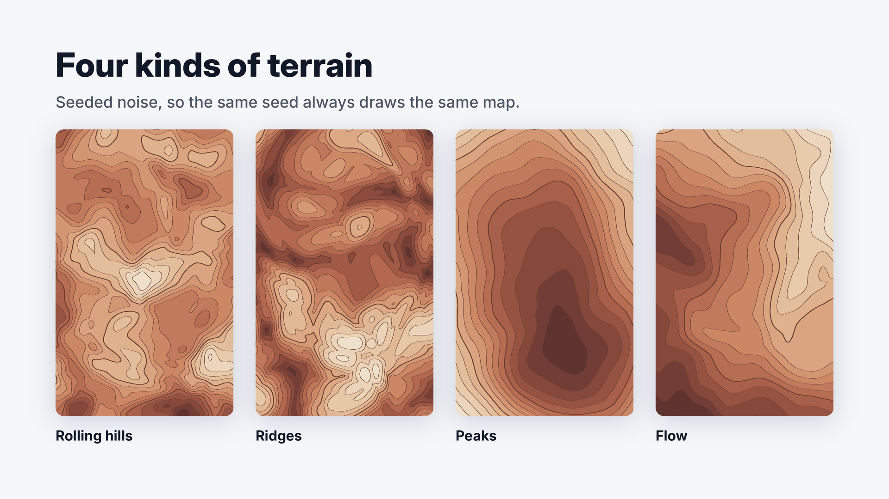
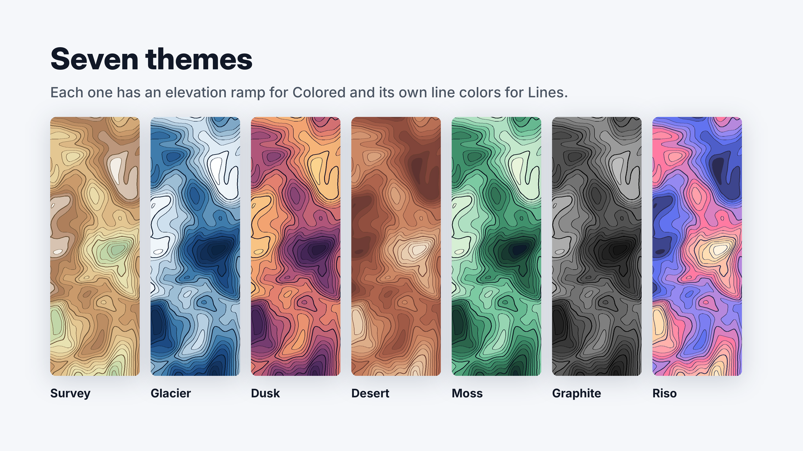
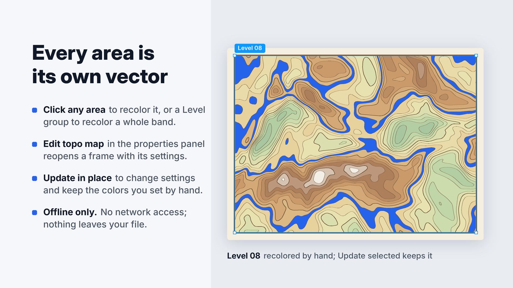

# Topo Maker



**Generate editable vector topo maps and contour lines in Figma.**

[](https://www.figma.com/community/plugin/1707656122544155967)
[](https://www.figma.com/design/gW6y90WBjZFcdTA3jVQow9)
[](LICENSE)

Topo Maker generates abstract topographic contour maps as clean vector art. Every
elevation area is a **closed path** that becomes an individually selectable VectorNode in
Figma, grouped by contour level, so you can click any area (or a whole level) and recolor
it after generation.

- **Three styles:** Colored elevation bands, classic contour Lines, or an Outline ready to fill.
- **Four terrains:** rolling hills, ridges, peaks and flow, plus 7 curated themes.
- **Real vectors:** every band is a closed, even-odd path you can recolor by hand.
- **Update in place:** change the settings later and keep the colors you picked.
- **Reproducible:** the same seed and settings always give the same map.

| | |
|---|---|
|  |  |
|  |  |

## Install

- **From the Figma Community:** [Topo Maker](https://www.figma.com/community/plugin/1707656122544155967).
  Open it in any design file and run it from the Plugins menu.
- **Try it first:** duplicate the [Topo Maker playground](https://www.figma.com/design/gW6y90WBjZFcdTA3jVQow9).
- **From source:** see [Development](#development).

## Using the plugin

- **Style**:
  - *Colored*: stacked elevation bands filled from the theme, with contour strokes in
    the theme's ink color. Pick a **Coloring**: *Elevation ramp* (a smooth gradient low →
    high, like a hypsometric map) or *Cycle bands* (repeats the palette band by band, for
    a posterized, striped look).
  - *Lines*: classic contour-line art. Stroke-only paths on the theme's paper color, line
    color ramping with elevation.
  - *Outline*: black lines on white bands, for line art. Every band is a white
    area, ready to fill.
- **Theme**: 7 curated palettes (Survey, Glacier, Dusk, Desert, Moss, Graphite, Riso);
  hidden for Outline. Each has an elevation ramp for Colored and a separate, contrasting
  line ramp and paper for Lines.
- **Terrain**: the shape of the underlying height field:
  - *Rolling hills*: fractal (fBm) Perlin noise. Blobs, valleys and saddles.
  - *Ridges*: ridged multifractal noise. Sharp crests and dense, veiny contours.
  - *Peaks*: 3–6 seeded Gaussian summits plus a little noise. Bullseye islands.
  - *Flow*: a tilted plane plus noise. Long, roughly parallel, wavy lines.
- **Contours**: number of contour lines (2–60). The map has one more band than this.
- **Spacing**: *Even height* puts contours at equal elevation steps (steep areas get
  crowded lines, flats get wide bands). *Even area* puts them at height quantiles, so
  each band covers about the same share of the frame and lines spread out evenly.
- **Scale**: feature size in px, roughly the distance between neighboring hills.
  Because it's in px, a bigger frame shows more terrain rather than stretching it.
- **Roughness**: fine detail; adds noise octaves and raises their gain.
- **Warp**: domain warping. Swirls and folds the terrain into marbled, flowing shapes.
- **Smoothing**: Chaikin passes on every contour. 0 keeps the faceted marching-squares
  look, 3 is silky.
- **Index lines**: every Nth contour is drawn at double stroke, like the index contours
  on a survey map (*Off* at 0).
- **Stroke**: line width (0 = no strokes in Colored; Lines and Outline keep a minimum
  hairline so they never vanish).
- **Border**: a neatline around the map, in px (*Off* at 0). It's drawn in the theme's
  ink (black in Outline, the top line color in Lines). With a margin it sits just
  inside the mat, hugging the map; without one it runs along the frame edge.
- **Margin**: a paper mat between the frame edge and the map, in px (*Off* at 0),
  in the theme's paper color (white in Outline). The terrain still fills the whole
  frame and the mat covers its edge, so changing the margin or border never moves a
  contour. Both are capped at a quarter of the shorter side.
- **Size / Seed / 🎲 Shuffle**: same seed + params always reproduces the same map.
- **Insert into Figma** places the frame at the viewport center as `Topo <seed>`, with
  the background rect locked (unlock it in the Layers panel to recolor it).

### Layer structure

```
Topo 12345              ← frame, clips content
  Background            ← band 0, locked
  Level 01              ← group: everything at or above contour 1
    Area 01             ← one connected region (outer boundary + its pits, even-odd)
    Area 02
  Level 02
    …
  Mat                   ← only with a margin: even-odd ring, frame edge → map
  Border                ← only with a border: even-odd ring around the map
```

Levels stack bottom to top, so each band you see is "this level minus the next one up".
Selecting a `Level` group and changing its fill recolors the whole band. Contours run
past the frame edge on purpose (so no line traces the border); the frame's clip hides
the overflow.

### Update in place

While a generated frame (or anything inside it) is selected, the button becomes
**Update selected**: it regenerates that frame with the current settings and carries
over manual color overrides (any area or background whose fill, or stroke in Lines style,
differs from what the frame's stored settings generated):

- *Style, theme, coloring, stroke, index lines, border, margin* only restyle the same areas, so each
  override goes back on the same layer (`Level 03/Area 02` → `Level 03/Area 02`).
- *Size, terrain, contours, spacing, scale, roughness, warp, smoothing, seed* reshape
  the map, so area numbers can point at different shapes. Each override's area gets an
  anchor point inside it, scaled to the new frame size, and its level is mapped to the
  same relative height (level 3 of 10 → level 6 of 21). The override goes to the area at
  that level that contains the anchor, or else the nearest one within about 12% of the
  frame diagonal. Each new area takes at most one override (closest first).
- Switching to or from *Lines* moves the override between fill and stroke.
- A recolored background is always kept, and so are a recolored Mat and Border while
  they're still turned on. The notification says how many overrides were
  kept, e.g. *Kept 5 of 7 colors you changed by hand; 2 had no matching area.*
- While a frame is selected, an *Insert new* button also appears, for when you want a
  second map rather than replacing the selected one.

Selecting a frame also repopulates the panel with its stored settings, the same thing
the **Edit topo map** relaunch button in the properties panel does.

## Relaunch button

Every generated frame gets `setPluginData('topo-params', …)` (the full parameter set)
plus `setRelaunchData({ edit })`. Selecting the frame shows **Edit topo map** in the
properties panel; it reopens the plugin hydrated with that frame's settings. Stale or
corrupt stored params are coerced by `clampParams()`.

> **Plugin id**: `1707656122544155967`, issued by Figma at publish. **Never change it.**
> Plugin data and relaunch buttons are tied to the id, so frames made with another id
> lose their stored settings and their **Edit topo map** button.

## Development

### Build and import

```sh
npm install
npm run build     # → dist/code.js, dist/ui.html, dist/core.iife.js
```

Then in **Figma desktop**: Plugins → Development → **Import plugin from manifest…** →
pick `manifest.json` in this folder. Run it via Plugins → Development → Topo Maker.

### Dev gallery

```sh
npm run build
python3 -m http.server 8147   # then open http://localhost:8147/preview/gallery.html
```

(or start the `topo-gallery` server from `.claude/launch.json`). It renders 22 tiles
across styles × terrains × themes, plus extremes of every knob, and runs automated checks
with a pass/fail banner: determinism, every subpath closed with `Z`, no `NaN`, area and
level counts, Lines stroke-only, Outline all-white, Mat/Border present only when
turned on and drawn on top, **every level nests inside the level
below it** (validates the hole/outer classification), default-params speed, border and margin
never moving terrain, and
update-in-place matching (restyle = identity, resize ×2 keeps overrides on the same
level, re-seed claims each area at most once, more contours map to the same relative
height).

### Architecture

```
src/core/            pure, deterministic, no Figma or DOM
  rng.ts             mulberry32 (copied from voronoi-maker)
  noise.ts           seeded Perlin noise, fBm, ridged multifractal
  terrain.ts         terrain height functions + sampled grid (with margin and low ring)
  contours.ts        marching squares → oriented closed loops; Chaikin; Douglas–Peucker
  composer.ts        TopoParams, defaults, clampParams, thresholds, loops → areas, colors
  palettes.ts        7 themes (elevation ramp + line ramp)
  svg.ts             area shapes, layer names, SVG serializer, layer → color map
  match.ts           update-in-place override re-targeting
  index.ts           generate(params) → { svg, areaCount, levelCount, map }
src/main.ts          plugin thread: insert / update in place / target detection
src/ui/              360px panel; live preview is the exact SVG that gets inserted
preview/gallery.html dev gallery + checks
```

#### How a map is made

1. **Height field.** A seeded noise function (by terrain) is sampled on a grid
   (~60k samples max) that extends 56px past the frame on every side, then normalized
   so the in-frame samples span exactly [0, 1]. One extra ring of very low samples wraps
   the grid, which guarantees every contour is a closed loop. The part of a loop that
   follows that ring lies outside the frame, hidden by the clip.
2. **Thresholds.** `levels` heights, evenly spaced or at quantiles (*Even area*).
3. **Marching squares** per threshold, with saddles resolved by the cell-center
   average. Each segment is oriented so higher ground is always on the same side, so
   outer boundaries and pits wind in opposite directions.
4. **Areas.** The largest loop's winding marks outer boundaries; every opposite-wound
   loop is a hole in the smallest outer that contains it. Specks and loops fully outside
   the frame are dropped. Loops are smoothed (Chaikin) and simplified (Douglas–Peucker,
   0.3px), then each outer boundary + its holes is one even-odd path.
5. **Color.** Geometry and color use separate rng streams
   (`seed` and `seed ^ 0x9e3779b9`), so changing theme or style never moves a contour.

## License and privacy

MIT, see [LICENSE](LICENSE). Everything in `dist/` is built from this repo's `src/`. No
third-party code is bundled; the only dependencies are build tools (esbuild, TypeScript,
Figma's type definitions) that never ship. The seeded random number generator is
Tommy Ettinger's public-domain mulberry32. The listing images in `community/` set their
text in Inter (SIL Open Font License); the font itself is not included.

The plugin declares no network access and collects nothing: no analytics, no accounts,
no third-party services. It reads only the current selection (to recognize frames it
made) and writes only the frames it creates. Each frame carries its own settings as
plugin data so it can be reopened, and that data stays in the Figma file.
